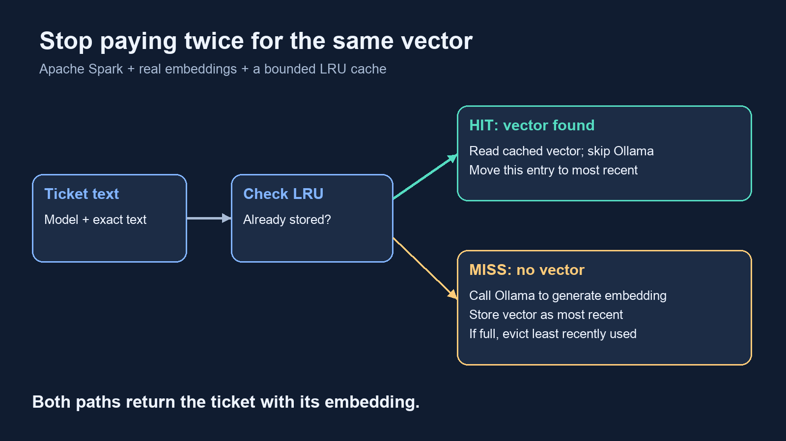
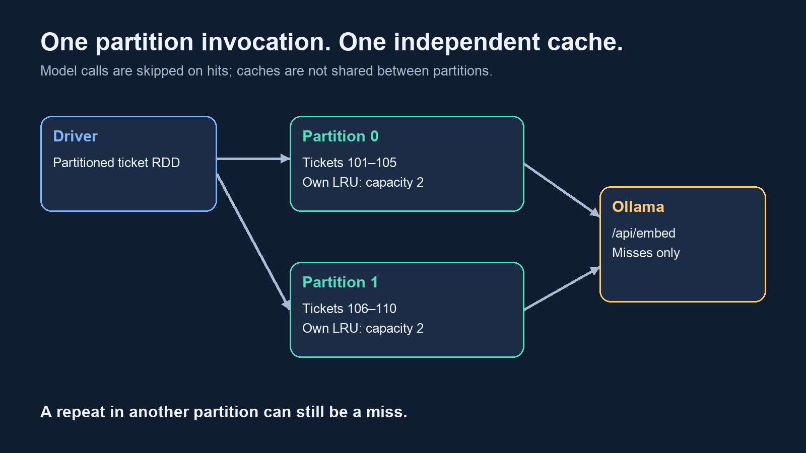
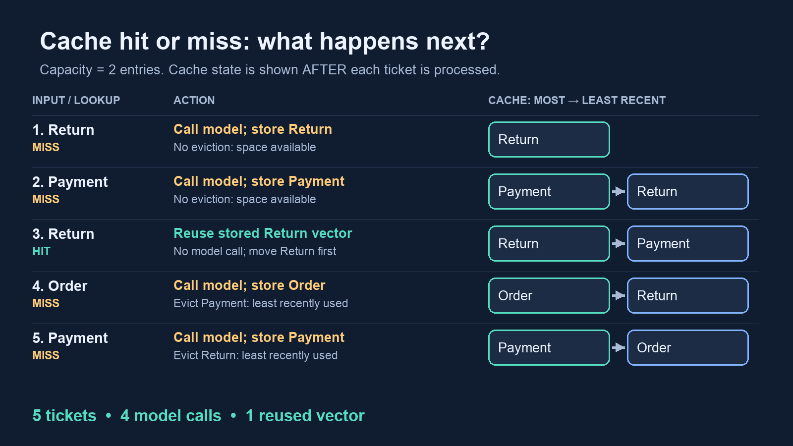
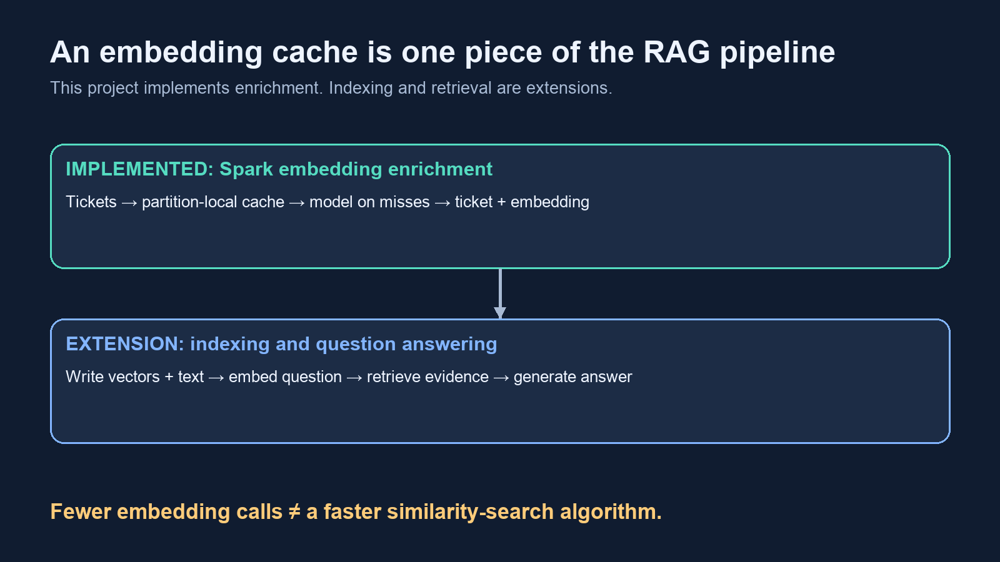

# Stop Paying Twice for the Same Vector: Spark Meets the LRU Cache

*How a small cache can remove repeated AI embedding calls—and why its location inside a Spark job matters.*



A support pipeline receives the same sentence twice: “My payment failed.” The ticket IDs are different. The text is identical. The embedding model is identical.

Should the model have to do the same work twice?

Without reuse, it will. Distributing that work with Spark gives us more ways to execute it concurrently, but repeated inputs still trigger repeated inference. Before adding more workers, it is worth asking how much work we could avoid entirely.

This project combines three familiar ideas: Spark partitions the workload, Ollama runs `nomic-embed-text` to turn text into real embedding vectors, and an LRU cache remembers recently computed results. The interesting part is where those ideas meet: each partition invocation owns its own bounded cache.

## The work we want to avoid

Imagine enriching support tickets with embeddings so a downstream system can match them against help articles. Every ticket needs its output record, but two tickets with the same model and input text can reuse one vector.

That gives us a simple contract:

```python
key = (model, text)
value = embedding_vector
```

The ticket ID stays out of the key. It identifies the business record; it does not determine the embedding.

For fixed model weights and settings, this lets us reuse an embedding while preserving every ticket. The cache does exact matching. “My payment failed” and “Payment did not go through” remain different keys, even if a semantic search engine might consider their vectors similar.

**We are caching the computation that produces a vector.** A later retrieval system can use that vector to search an index. This job implements embedding enrichment; it does not yet implement vector retrieval or a complete RAG application.

## Put the cache where the work happens

The driver creates the input RDD and registers the processing function:

```python
processor = partial(
    process_partition,
    capacity=capacity,
    use_cache=use_cache,
    provider=provider,
    model=model,
    ollama_url=ollama_url,
)
return tickets.mapPartitionsWithIndex(processor).collect()
```

The settings are bound once. Spark supplies each partition's index and record iterator when it invokes the processor. The partition-oriented API lets us initialize a cache once and reuse it across records in that invocation.



Here is the important setup from `process_partition()`:

```python
cache = LRUCache(capacity) if use_cache else None

if provider == "ollama":
    service = OllamaEmbeddingService(ollama_url)
    model = model or "nomic-embed-text"
```

The pipeline uses the Ollama provider throughout this walkthrough. Each cache miss sends the ticket text to the embedding model; each hit reuses a previously returned vector.

The placement of the cache is deliberate. It is created inside the partition function, so it starts empty for each invocation. It is neither shared across executors nor retained for the next job. Reusing a Python worker process does not change that lifecycle: the next invocation creates a new object.

`collect()` makes the tiny demonstration easy to inspect. For a large dataset, replace it with a distributed output path rather than pulling every vector into driver memory. Spark's documentation explains both partition processing and the risks of collecting large results in its [RDD programming guide](https://spark.apache.org/docs/4.0.0/rdd-programming-guide.html).

## The entire optimization lives in one loop

The central path is short enough to read without the surrounding application:

```python
for ticket_id, text in tickets:
    key = (model, text)
    cache_hit = False

    if cache is not None:
        try:
            vector = cache.get(key)
            cache_hit = True
        except KeyError:
            pass

    if not cache_hit:
        vector = service.embed(model, text)
        if cache is not None:
            cache.put(key, vector)
```

A hit skips inference. A miss computes the vector and inserts it. The function then yields a record containing the original ticket ID and text, the vector, the partition ID, and a cache-hit flag.

This distinction matters: avoiding a model call does not mean dropping a duplicate ticket. Both business records still flow downstream.

## Why LRU fits this problem

A cache that remembers every distinct input can grow without bound. An LRU cache caps the entry count and removes the least recently used item when full.

Our implementation uses a dictionary for average constant-time lookup and a doubly linked list for constant-time changes to recency order. A hit moves the existing node to the front. Insertion also happens at the front; eviction removes the last real node.



Consider a partition with these five texts:

```text
Return → Payment → Return → Order → Payment
```

With capacity two, the first two inputs miss. The repeated Return hits and becomes most recent. Order then displaces Payment. When Payment appears again, it misses because it has already been evicted.

The result is four embedding calls for five tickets. Locality matters: repeats only help while the entry is still present.

Capacity here means entries, not megabytes. With fixed-length vectors it is a convenient teaching control, but a production memory budget must account for text keys, Python objects, and vector storage too.

## Generate embeddings with Ollama

The embedding service sends a request to Ollama. This excerpt shows the request; the full adapter also handles request failures and validates that the response contains one nonempty vector of finite numbers.

```python
request = Request(
    self.base_url + "/api/embed",
    data=json.dumps({
        "model": model,
        "input": text,
        "truncate": False,
    }).encode(),
    headers={"Content-Type": "application/json"},
)

with urlopen(request, timeout=300) as response:
    result = json.load(response)
```

Ollama's [embedding API](https://docs.ollama.com/api/embed) accepts text inputs and returns vectors. Setting `truncate=False` makes an oversized input fail rather than silently changing the text that gets embedded.

Every Spark worker needs to reach the configured endpoint. `127.0.0.1` works for this local demonstration because the workers and Ollama run on the same machine. In a cluster, it refers to each worker's own host, so the service URL must match the deployment.

Parallel requests also need an inference service that can handle the load. More Spark tasks cannot manufacture additional model-serving capacity; they may simply create a longer queue.

## What the example actually demonstrates

The controlled Spark input repeats the five-ticket sequence across two partitions, with distinct ticket IDs. Each partition starts with an empty cache.

Tracing the input order gives the following expected call counts for a successful pass with no task retries:

```text
No cache:        10 tickets → 10 embedding calls
LRU capacity 2:  10 tickets →  8 embedding calls
LRU capacity 3:  10 tickets →  6 embedding calls
```

The capacity-two result avoids 20% of calls in the accepted task outputs. That is a call-count reduction, not a measured 20% reduction in elapsed time. Capacity three retains all three distinct texts within each partition, so each partition needs only three calls. Those counts follow from the controlled order; arbitrary datasets will behave differently.

A cache hit returns the stored vector directly. When comparing cached and uncached runs, the code allows small floating-point differences between repeated inference requests.

The eleven unit tests pass, including mocked Ollama request and cache-reuse checks. The counts above describe the cache logic; they are not a live model-serving benchmark. End-to-end Spark-plus-Ollama inference and elapsed-time improvements still need to be measured on a running deployment.

A useful latency model is:

```text
time ≈ inference time on misses
     + cache lookup and insertion overhead
     + Spark scheduling, serialization, and communication
```

Tasks can overlap, so this is a way to reason about costs rather than an elapsed-time formula. Fewer calls help most when inference is expensive and inputs repeat locally. A cache can add overhead when almost every text is unique.

## Three lessons that matter beyond this demo

**A local cache has a local view.** The same sentence in two partitions can generate two calls. More partitions can fragment reuse; fewer partitions can reduce concurrency. Measure the tradeoff on representative input rather than choosing a partition count for cache hit rate alone.

**Spark's dataset cache solves a different problem.** `cache()` and `persist()` retain computed dataset partitions for reuse. Our Python LRU reuses individual model-and-text results while processing a partition. It lives in Python worker memory, outside Spark's managed JVM execution/storage region.

**Retries can repeat external work.** A failed or speculative task attempt can issue calls that do not appear in the accepted output. Our reported call counts come from output records; they are not a complete endpoint request log. Use service-side metrics to measure actual inference requests, and use stable IDs and idempotent writes when adding a persistent vector index.

The cache identity must also keep pace with the model configuration. This example fixes the endpoint and embedding settings for a run. If model versions, dimensions, or preprocessing can vary, include their identities in the key and avoid changing a model behind an existing tag mid-run.

## When I would choose a different approach

For a batch with many duplicates scattered across partitions, deduplicating `(model, text)`, embedding each distinct input, and joining the results back to ticket IDs may avoid more work. That introduces a shuffle and a join, so it should be compared against the cost of repeated inference.

For reuse across workers and runs, a shared cache can help. It adds network latency and operational responsibilities; concurrent misses may still duplicate inference unless coordinated.

For high-throughput inference, batch the remaining misses if the serving system supports it. Our example deliberately makes one request per miss so the relationship between input order, cache state, and model calls stays visible.

## Where this fits in RAG



In document ingestion, Spark could chunk documents, reuse embeddings for repeated text, and write vectors with text and metadata to a searchable index. At question time, a service would embed the question, retrieve relevant chunks, and give those chunks to a language model.

This project stops at ticket enrichment. It does not search help articles or generate grounded answers yet. An embedding cache can reduce repeated query-embedding work in an extended system, but it does not speed up the vector index's similarity-search algorithm by itself.

That boundary makes the optimization easier to evaluate: we know exactly which computation a hit avoids.

## Try the pipeline

With Spark, Java, Python, and Ollama available, start `ollama serve` in a separate terminal. Then run:

```bash
ollama pull nomic-embed-text
cd spark-lru-learning

spark-submit --master 'local[2]' spark_job.py \
  --provider ollama --capacity 2 --partitions 2
```

Choose an installed compatible worker Python interpreter through `PYSPARK_PYTHON` if needed. Increasing capacity from two to three is a small experiment with a visible effect: Payment survives long enough to be reused.

The question to carry into a larger pipeline is straightforward: before scaling inference, how much repeated work can we safely remove?

**Code:** [View the complete project on GitHub](https://github.com/REPLACE-WITH-YOUR-REPOSITORY)
